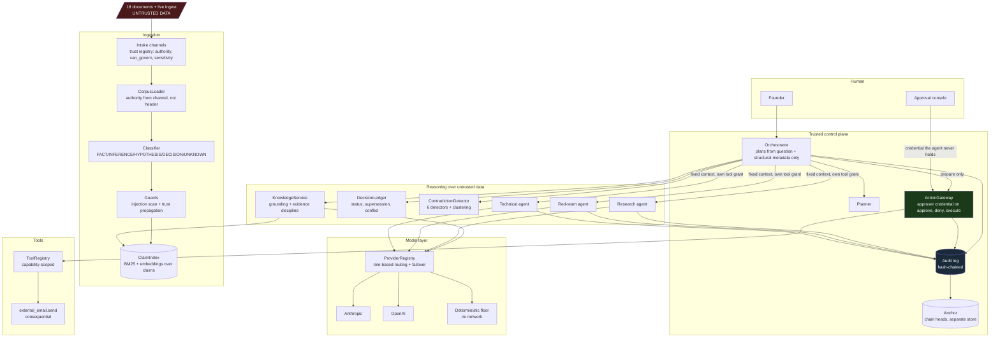

# Founder Intelligence Agent

A working prototype of an institutional-memory agent for Veritas Chain Technologies,
built against the supplied 18-document set.

The document set is deliberately inconsistent: a founder decision, an engineering
rollout that quietly contradicts it, a board decision that reverses the rollout
without naming it, a superseded policy, two untested hypotheses, a commitment that
slipped, and an external article that disagrees with all of it. A retrieval system
that averages those into fluent prose is worse than no system at all, because it
launders an unratified deviation into "company policy". Everything below follows
from refusing to do that.

## Architecture



Red: untrusted data. Green: the human authorization boundary. Blue: the audit log. Authority comes from the channel a document arrived through, never from what the document says about itself. Document text never reaches the planner; the agent can prepare a consequential action but has no code path to execute one. Full walkthrough in [docs/ARCHITECTURE.md](docs/ARCHITECTURE.md).

## Where each assessment requirement is answered

| Assessment section | Where |
|---|---|
| §2.1 Knowledge retrieval | `founder_agent/knowledge.py`, `retrieval.py` · demo §2.1 · `tests/test_grounding.py` |
| §2.2 Decision retrieval | `founder_agent/decisions.py` · demo §2.2 · `tests/test_decisions.py` |
| §2.3 Contradiction detection | `founder_agent/contradictions.py`, `stance.py` · [table below](#contradictions-found-in-the-supplied-set) · `tests/test_contradictions.py` |
| §2.4 Classification | `founder_agent/classify.py` · demo §2.4 · `tests/test_classification.py` |
| §2.5 Agent delegation | `founder_agent/agents/` · demo §2.5 · `tests/test_hosted_path.py` |
| §2.6 Human authorization | `founder_agent/authorization.py`, `tools/` · demo §2.6 · `tests/test_authorization.py` |
| §2.7 Auditability | `founder_agent/audit.py` · demo §2.7 · `tests/test_audit.py` |
| §3 Security exercise | [docs/THREAT_MODEL.md](docs/THREAT_MODEL.md) · `tests/test_security.py` · live `POST /api/security/selftest` |
| §4 Architecture question (provider swap) | [docs/ARCHITECTURE.md §4](docs/ARCHITECTURE.md#4-changing-model-providers) · `founder_agent/llm/` |
| §5 Final question (never autonomously) | [docs/AUTONOMY_BOUNDARY.md](docs/AUTONOMY_BOUNDARY.md) |
| §6 Working prototype | `./run.sh demo` (no key needed) · `./run.sh serve` · [docs/DEMO_TRANSCRIPT.md](docs/DEMO_TRANSCRIPT.md) |
| §6 Architecture diagram | [above](#architecture) · [docs/ARCHITECTURE.md](docs/ARCHITECTURE.md) (with plain-text fallback) |
| §6 Threat model | [docs/THREAT_MODEL.md](docs/THREAT_MODEL.md) |
| §6 Known limitations | [docs/LIMITATIONS.md](docs/LIMITATIONS.md) |
| §6 Next three engineering steps | [docs/LIMITATIONS.md → next steps](docs/LIMITATIONS.md#recommended-next-three-engineering-steps) |
| Recommended modifications (review) | [below](#recommended-modifications-implemented) |

---

## Quickstart

```bash
cd founder-agent
python3 -m venv .venv && .venv/bin/pip install -r requirements.txt
```

Run the guided walkthrough of all seven capabilities:

```bash
.venv/bin/python -m founder_agent.cli demo
```

Run the web UI:

```bash
.venv/bin/python -m founder_agent.cli serve    # http://127.0.0.1:8000
```

Every `/api/*` route, reads included, needs the API credential
(`Authorization: Bearer $FA_API_TOKEN`, dev default `dev-api-token`); the console
asks for it once. Approve, deny and execute additionally need the approver
credential (`X-Approver-Token: $FA_APPROVER_TOKEN`, dev default
`dev-human-console-token`), which the agent process never uses. With
`FA_ENV=production` the process refuses to start while either is unset or still a
`dev-` placeholder. All settings: [.env.example](.env.example).

Feed a document to the running server through a channel; it is indexed and
governs (or not) immediately, without a restart. `upload` needs no connector
credential and is quarantined; `board`, `founder`, `engineering` and the other
trusted channels need `X-Connector-Token`. The `authority:` line inside the file
is recorded but ignored.

```bash
python3 -c 'import json,sys; print(json.dumps({"markdown": sys.stdin.read()}))' < note.md | curl -s http://127.0.0.1:8000/api/ingest/upload -H "Authorization: Bearer $FA_API_TOKEN" -H "X-Filed-By: ana" -H "Content-Type: application/json" -d @-
```

`cli.py ingest <channel> <file> [--token …]` does the same offline, and
`cli.py attention` (or `GET /api/attention`) lists what needs a human: Approve,
Decide, FYI.

Run the tests, including the attacks against our own controls:

```bash
.venv/bin/python -m pytest tests -q            # 200 pass; 5 live tests skip without FA_LIVE=1
```

**No API key is required.** With `ANTHROPIC_API_KEY` or `OPENAI_API_KEY` set, the
system uses a hosted model to phrase answers and to add a second opinion in the
subagents. Without one it runs a deterministic path: answers are composed
extractively from the source sentences. Retrieval, classification, the decision
ledger, contradiction detection, delegation and every authorization control are
identical either way, because none of them live in a prompt. See
[docs/ARCHITECTURE.md](docs/ARCHITECTURE.md#4-changing-model-providers).

The hosted path is covered two ways. `tests/test_hosted_path.py` uses a scripted
fake provider (no network): model output that cites real claims is used; uncited or
fabricated sentences are dropped; a confidently-worded restatement of a hypothesis
stays labelled HYPOTHESIS; a provider failure trips failover to the local floor.
`tests/test_live.py` runs the same guarantees against the real API and is opt-in:

```bash
FA_LIVE=1 .venv/bin/python -m pytest tests/test_live.py -q -s
```

Default hosted model is `claude-haiku-4-5` (cheap, fast); override with `FA_ANTHROPIC_MODEL=claude-sonnet-5` or `claude-opus-5` for stronger synthesis. Put the
key in `.env` (gitignored) — `run.sh` loads it. The ordinary test suite strips any
API keys from its environment so it never spends money.

---

## The seven capabilities

| § | Capability | Where it lives | What it does that a naive version would not |
|---|---|---|---|
| 2.1 | Knowledge retrieval | `knowledge.py`, `retrieval.py` | Hybrid BM25 + embeddings over claims, gated by a 64-question eval set. Cites at claim level, not document level. Returns **UNKNOWN** with a description of the gap when evidence is thin or the question's subject is absent from the corpus, instead of composing something plausible. |
| 2.2 | Decision retrieval | `decisions.py` | Returns the governing record, its status, source, rationale, its full lineage (found from any link in the chain, even when search only surfaced an old one), and whether your proposal **conflicts** with it — plus who has the authority to overturn it. |
| 2.3 | Contradiction detection | `contradictions.py`, `stance.py` | Six detectors that explain *why* two statements are incompatible (shared proposition, incompatible positions), then cluster the pairs into the handful of issues a founder actually has. |
| 2.4 | Classification | `classify.py` | FACT / INFERENCE / HYPOTHESIS / DECISION / UNKNOWN, rule-first with a quotable trigger for every label. Explicit vetoes stop the two conversions that matter: recommendation → decision, and hypothesis → fact. |
| 2.5 | Agent delegation | `agents/` | Research, red-team and technical subagents with their own tool grants, fixed context, token budgets and typed results. Citations are validated against the claims the parent handed over. |
| 2.6 | Human authorization | `authorization.py` | Consequential actions can be *prepared* but have no code path to execution without a human principal presenting a credential the agent process never holds — on approve, deny **and** execute. Approval is bound to a hash of the exact payload; execute is at-most-once across retries and crashes; internal-only claims cannot be put in an outbound message. |
| 2.7 | Auditability | `audit.py` | Hash-chained append-only log with chain heads copied to a separate anchor store, so a full rewrite or truncation fails verification. `reconstruct(trace_id)` returns request, retrieved context, model, delegations, tool request, output, human decision, denials, refused attempts and resulting action. Secrets are redacted **before** the write. |

---

## Recommended modifications implemented

From the review's design rule: *institutional logic (what is a decision, what
conflicts, whether something may be sent) stays in code; models only phrase
answers; a prompt is not a control.* Every row below is enforced in Python and
held by a test that fails if the logic breaks.

| § | Change | Where | Held by |
|---|---|---|---|
| 4.1 | Authority comes from the intake channel. A trust registry (`config.TRUST_REGISTRY`) maps channel → authority, may-govern, quarantine, sensitivity. `POST /api/ingest/<channel>`; trusted channels need a per-channel connector credential; `upload` is quarantined and cannot govern. The file's own `authority:` line is stored as `declared_authority` and ignored. Each document records channel, filed_by, received_at. Seed provenance lives in `corpus/provenance.jsonl`. | `ingest.py`, `app.py`, `api.py` | `test_provenance.py`, `test_api.py` |
| 4.2 | 64-question labelled eval set (direct, paraphrase, adversarial, out-of-corpus) gating every retrieval change, with a recall@8 / MRR ratchet on the raw index. Hybrid BM25 + embeddings behind the unchanged `ClaimIndex.search`: offline hashing embedder by default, any OpenAI-compatible endpoint via `FA_EMBEDDINGS=http`. UNKNOWN now also fires when the question's subject is absent from the corpus. | `retrieval.py`, `knowledge.py` | `test_retrieval_eval.py` |
| 4.3 | Decision lineage is walked from any link: a search that only finds DOC-01 still returns DOC-10 as governing. Mid-history shows DOC-02 as INFORMAL before the board ruled. Claims carry the date of the event they name, not the filing date. | `decisions.py`, `ingest.py` | `test_decisions.py`, `test_retrieval_eval.py` |
| 4.4 | Approve, deny and execute all need the approver credential. `FA_ENV=production` refuses dev or empty secrets. Execute is at-most-once (EXECUTING persisted before the send, idempotency key on the wire, retries replay the recorded result). Expiry runs on an injectable clock. Every `/api/*` route needs the API credential. SSO is left for later. | `authorization.py`, `config.py`, `api.py` | `test_authorization.py`, `test_api.py` |
| 4.5 | Chain heads are copied to a separate anchor file (`FA_AUDIT_ANCHOR`): every 25 records and immediately on execution or ingest. A rewritten or truncated log fails verification. `reconstruct()` adds denials and refused attempts. | `audit.py` | `test_audit.py` |
| 4.6 | Ingest re-indexes, re-ledgers and re-clusters in-process. No restart needed. | `app.py` | `test_provenance.py` |
| 4.7 | Stance positions are keyed by (axis, subject), so the same axis about different things is not a contradiction. The axes are ops-owned data. | `stance.py`, `contradictions.py` | `test_contradictions.py` |
| 4.8 | Every rule in the classification table has an example that must hit it first. DECISION claims in a superseded document are demoted, with the reason recorded. | `ingest.py` (rules unchanged in `classify.py`) | `test_classification.py` |
| 4.9 | `corpus.search` is wired to the live index, scoped to the grant, and never returns quarantined text. Document text cannot create an action plan. Helpers refuse tools outside their grant. No new agent types. | `agents/`, `app.py` | `test_delegation.py` |
| 4.10 | Synthesis asks for schema JSON (sentence + claim ids) and checks it with the same citation rules as prose. Prose remains as a fallback. An optional OpenAI-compatible local provider is registered when `FA_LOCAL_URL` is set. No new SDKs. | `knowledge.py`, `llm/` | `test_hosted_path.py`, `test_live.py` |
| 4.11 | Claims carry a sensitivity label from their channel or intake record. External drafts use only `customer_shareable`/`public` claims and list what was withheld. The gateway refuses internal claims, whether cited or pasted in. | `ingest.py`, `authorization.py`, `agents/orchestrator.py` | `test_authorization.py` |
| 4.12 | Attention queues: **Approve** (pending actions), **Decide** (open conflicts, slipped promises), **FYI** (conflicts the record already settles, recommendations nobody has ratified). `GET /api/attention`, `cli.py attention`. | `app.py` | `test_provenance.py` |
| 4.13 | Each API test has its own temp store (`FA_VAR_DIR` is set before import). Expiry tests advance a fake clock. | `tests/conftest.py` | every test |

Out of scope, as the review advised: UI polish, fine-tuning, a bigger agent swarm,
moving rules into prompts, and an external governance toolkit.

---

## What it looks like in practice — live on `claude-haiku-4-5`

Real output from `./run.sh demo` with a key set. Everything in **prose** below is
model-written; every citation, label, status, conflict verdict, refusal and audit
event is computed in code and comes out identical without a key. Full transcript:
[docs/DEMO_TRANSCRIPT.md](docs/DEMO_TRANSCRIPT.md).

**2.1 Knowledge retrieval** — cited, labelled, and UNKNOWN when the record is silent.
The custody line cites the board record DOC-10, not the founder memo it reaffirmed:

```text
Q: What signing algorithm and key custody boundary do we use?
verdict: ANSWERED   plan=decision_check provider=anthropic trace=tr_2cf9707635a14472
  [FACT] Veritas Chain uses ECDSA P-256 for all production signing operations.  ['DOC-04#c1']
  [FACT] Key generation occurs exclusively within the custody provider's HSM boundary, with private key material never leaving the HSM.  ['DOC-04#c2']
  [DECISION] Veritas Chain will maintain ColdVault as its sole, exclusive custody provider going forward.  ['DOC-10#c1']
  ! DOC-01 is contested by DOC-02.
  ! DOC-02 is SUPERSEDED by DOC-10 - historical, not current policy.

Q: What is our Series A valuation?
verdict: UNKNOWN   plan=decision_check provider=anthropic trace=tr_0f882f2572c64f40
  ? The supplied document set does not contain material that answers this.
  ? The question's subject (series, valuation) appears nowhere in the corpus; matching its incidental words would be a guess.
  ? Closest material: DOC-09#c4 (Incident Report: ColdVault Outage), DOC-14#c1 (Decision: Data Retention Policy), DOC-07#c3 (Follow-up: EU Latency Investigation) - related but not responsive.
  ? To answer it, the corpus would need a record stating this directly.
  ! Answered UNKNOWN rather than inferring from weakly related material.
```

**2.2 Decision retrieval** — governing record, status, rationale, and the conflict
with what you are proposing:

```text
governing : DOC-10 [ACTIVE] board 2026-07-30
source    : Board Meeting Minutes (excerpt)
decision  : The board reaffirmed the original vendor strategy: Veritas Chain will maintain ColdVault as its sole, exclusive custody provider going forward, citing cost discipline and integration simplicity. KeyForge integration should be wound down over the next two months.
rationale : citing cost discipline and integration simplicity
history   : [('DOC-02', 'SUPERSEDED'), ('DOC-01', 'ACTIVE')]

conflict with your proposal (high):
  The proposal takes position 'multiple' on how many custody providers hold production signing keys, while DOC-10 (ACTIVE, board, 2026-07-30) holds 'single'. Exclusivity is a cardinality claim about the same function at the same time: 'exclusive provider' means at most one. A second provider running live in production for that same function makes the exclusivity claim false. The two statements are not different words for one arrangement - they describe arrangements that cannot both hold. Adopting the proposal requires reversing DOC-10, which is a decision for board-level authority, not an implementation detail.
```

**2.5 Delegation** — the red team leads with governance; the research agent reports
the superseded rollout as history because the evidence it was handed carried the
ledger status:

```text
redteam  status=ok confidence=0.80 provider=anthropic/claude-haiku-4-5-20251001
  task      : Should we add KeyForge as a second custody provider?
  summary   : The strongest objection is that the board has already made an explicit decision to maintain ColdVault as the sole custody provider and to wind down KeyForge integration over two months, directly contradicting this proposal. Adding KeyForge would also reverse the board's stated commitment to cost discipline, given that dual-provider custody has already increased spending by 40 percent compared to Q1 baseline costs. The original decision to use ColdVault exclusively was grounded in a clean security review and current SOC 2 Type II certification, eliminating the justification for redundancy. Any re-evaluation would require new board authorization rather than reinstatement of a practice the board has explicitly rejected.
  finding   : [BLOCKING] The proposal takes position 'multiple' on how many custody providers hold production signing keys, while DOC-10 (ACTIVE, board, 2026-07-30)
  finding   : [STALE] Cites superseded records: DOC-02#c1 (DOC-02), DOC-02#c4 (DOC-02)
  finding   : [CONTESTED RECORD] The supplied material takes more than one position (['multiple', 'single']). Any answer must say which one governs, not average the

research  status=ok confidence=0.90 provider=anthropic/claude-haiku-4-5-20251001
  task      : Should we add KeyForge as a second custody provider?
  summary   : The record has already closed this question. A decision established that Veritas Chain will use ColdVault as its exclusive custody provider, justified by the measured fact that ColdVault's HSM cluster passed internal security review with no critical findings and maintains current SOC 2 Type II certification, despite measured costs 15% higher than KeyForge. An interim onboarding of KeyForge as a secondary provider occurred during Q2 infrastructure work, but this was superseded by a board decision reaffirming ColdVault as sole provider and directing KeyForge integration to be wound down over two months. The record does not present this as an open question for decision.
  finding   : [DECISION] Decision: Veritas Chain will use ColdVault Inc. as our exclusive key-custody provider for all production signing keys, effective immediatel
  finding   : [DECISION] The board reaffirmed the original vendor strategy: Veritas Chain will maintain ColdVault as its sole, exclusive custody provider going forw
  finding   : [DECISION] KeyForge integration should be wound down over the next two months. (DOC-10#c2, 2026-07-30)
```

**2.6 Human authorization** — the draft carries only material cleared for external
release; internal board and finance claims are withheld by code, then the action is
refused three different ways:

```text
prepared  : act_17d8dcf167fd  status=PENDING_HUMAN_AUTHORIZATION
cites     : ['DOC-05#c2', 'DOC-05#c1', 'DOC-11#c1']  (cleared for external release only)
intent    : Send an external email to compliance@northbridge.example summarising the position of record in response to: "Send Northbridge Bank our current custody position of record". Irreversible once sent.
hash      : c41857323499f20cb8865d89b65d3c9ac1a40a8d5bdcc8ab779d75ed683c9bc2
warning   : Withheld internal-only material from the draft: DOC-10#c1, DOC-10#c2, DOC-06#c1.

attempt 1 - the agent tries to approve its own action
  refused: only a human principal may approve an action

attempt 2 - execute without approval
  refused: cannot execute: action is PENDING_HUMAN_AUTHORIZATION, not APPROVED

attempt 3 - a human approves, then the payload is tampered with
  refused: payload changed after approval; execution refused
```

**2.7 Audit** — the same interaction, reconstructed, and checked against the
separately stored chain heads:

```text
trace tr_fe336de44927492b: 8 events
  #15   08:14:01  founder                      user_request
  #16   08:14:02  retrieval                    retrieval
  #17   08:14:02  knowledge_service            model_call
  #18   08:14:02  orchestrator                 plan
  #19   08:14:04  redteam                      delegation
  #20   08:14:06  research                     delegation
  #21   08:14:08  technical                    delegation
  #22   08:14:08  orchestrator                 response

chain verification: {'ok': True, 'records': 35, 'head': 'bf77f4192442ca3625b17d123848f870d52c9772b5b10cf435d6b587b536519a', 'anchors_checked': 1}
```

**Provenance** — the same forged "board resolution", filed twice. Authority is
assigned by the channel; what the file says about itself is recorded and ignored:

```text
same note, filed via 'upload' -> DOC-81
  declared authority : board
  assigned authority : unknown   quarantined=True
  custody governed by: DOC-10

same note, filed via 'board' -> DOC-82
  declared authority : board
  assigned authority : board   quarantined=False
  custody governed by: DOC-82
```

The most important line in the whole run is in §2.3 below: DOC-02 changed
production while stating that *no decision document was filed*. That is not two
documents disagreeing — it is the operating state diverging from the decision log
with nothing revoking it, and a similarity-search system cannot produce it.

## Contradictions found in the supplied set

| Severity | Issue | Documents | Detector |
|---|---|---|---|
| high | How many custody providers govern production signing keys | DOC-01, DOC-02, DOC-06, DOC-10 | stance axis: cardinality |
| high | Production changed without a decision record | DOC-01, DOC-02 | governance gap |
| medium | External commitment not met on its original terms | DOC-15, DOC-16 | commitment deadline vs later status |
| low | Policy superseded in the record (3-year → 7-year retention) | DOC-14, DOC-17 | explicit supersession marker |
| low | Internal decision diverges from stated industry practice | DOC-01, DOC-08, DOC-10 | external reference vs internal decision |

Equally important is what it does **not** report. DOC-05 (promise of quarterly
attestation) and DOC-11 (attestation delivered on time) are not a contradiction.
DOC-03's untested latency hypothesis is never reported as conflicting with a
decision, because a hypothesis and a decision are different kinds of statement —
that gate is asserted in `tests/test_contradictions.py`.

---

## The console

`./run.sh serve` → http://127.0.0.1:8000. Single HTML file, no build step, no CDN.

| Tab | Shows |
|---|---|
| **Ask** | Landing overview (claim-type distribution, what governs today, contradiction counts). After a question: verdict, labelled segments with clickable citations, retrieved evidence with scores and currency notes, governing decision + history timeline, plan → delegation pipeline with each subagent's findings, contradictions touching the answer, and any prepared action. |
| **Documents** | Every document with the channel it arrived through (`founder via founder`, `unknown via upload`) and a QUARANTINED marker; every claim with its label, the trigger phrase that produced it, confidence and sensitivity. |
| **Decisions** | The ledger — status, authority, rationale, lineage — and a timeline. |
| **Contradictions** | The five issues, each with why the positions conflict, the resolution, and what governs today. |
| **Authorization** | Pending actions with payload hash, evidence, and a list of internal claims withheld from the draft. Approve, deny and execute each take the approver credential. A missing or wrong credential shows the gateway's refusal inline. |
| **Audit** | Chain status; pick any interaction and see it reconstructed as the seven fields §2.7 asks for. |
| **Security** | Runs the eleven-control self-test against live code paths. |

Any citation chip opens the source document in a drawer with the cited claim highlighted.

## Documentation

- **[docs/ARCHITECTURE.md](docs/ARCHITECTURE.md)** — component diagram, data flow, and the answer to §4 (swapping model providers, adding email/calendar/GitHub/local models).
- **[docs/THREAT_MODEL.md](docs/THREAT_MODEL.md)** — §3: how I would attack this system, what stops each attack, and which protections are in code rather than in prompts.
- **[docs/AUTONOMY_BOUNDARY.md](docs/AUTONOMY_BOUNDARY.md)** — §5: what this agent must never do autonomously, and why.
- **[docs/LIMITATIONS.md](docs/LIMITATIONS.md)** — known limitations and the next three engineering steps.

---

## Design decisions worth defending

**Correctness logic is in code, not in prompts.** Classification, supersession,
contradiction detection and every authorization control are deterministic Python.
A model is used for phrasing and for a second opinion. This is not model
scepticism — it is that institutional memory needs the same answer every time and
an audit trail that means something, and a token predictor gives you neither.

**Claims, not documents, are the unit of retrieval.** DOC-07 contains a measured
fact, an inference, and an explicit statement that no decision was made. Citing
the document would blur all three. Each sentence carries its own id, epistemic
label, date and authority.

**The epistemic label is data that travels.** It is attached at ingestion, carried
through retrieval, and used to label each answer segment. An answer segment is
labelled by the *weakest* evidence holding it up, so a hypothesis cannot be
laundered into a fact by being summarised.

**The planner never sees document text.** Routing decisions use the user's question
plus structural metadata (document ids, epistemic labels, scores). No sentence in
the corpus can cause an agent to be spawned or a tool to be chosen.

**Trust is a property of the channel.** A document's authority comes from the
connector it arrived through, never from its own header: a forged board minute
filed as an upload stays an upload. If one passage contains instruction-shaped
content, the whole document is quarantined. Someone who can write paragraph three
can also write paragraph four.

**Degrade, don't fail.** Every provider chain ends in a local deterministic floor.
A provider outage costs you prose quality, not the ability to answer or the
authorization controls.

---

## Project layout

```
corpus/                   18 source documents (markdown + frontmatter)
  provenance.jsonl        intake record per document: channel, filed_by, sensitivity
founder_agent/
  schemas.py              typed contracts shared by every layer
  ingest.py               documents -> claims; authority from channel, trust propagation
  classify.py             FACT / INFERENCE / HYPOTHESIS / DECISION / UNKNOWN
  stance.py               proposition axes used to compare positions
  retrieval.py            hybrid BM25 + embeddings over claims, dependency-free by default
  knowledge.py            grounded answering + evidence discipline
  decisions.py            decision ledger: status, supersession, conflict
  contradictions.py       six detectors + clustering
  guards.py               injection heuristics, redaction, trust boundary
  authorization.py        the human-in-the-loop gate
  audit.py                hash-chained append-only log + external chain-head anchor
  agents/                 orchestrator + research / redteam / technical
  llm/                    provider-neutral interface, routing, failover
  tools/                  capability-scoped tool registry
  api.py / cli.py         HTTP and terminal surfaces
ui/index.html             single-file console
tests/                    205 tests, including attacks on our own controls
  eval/retrieval.jsonl    64 labelled questions gating retrieval changes
```
